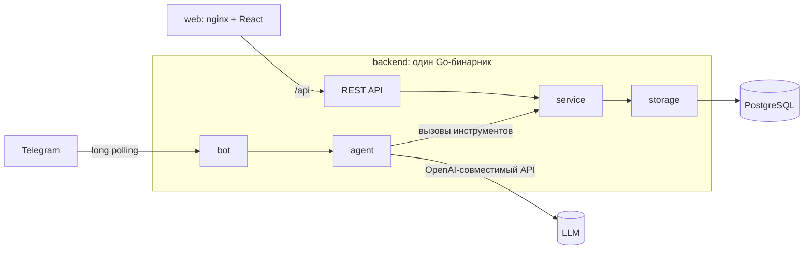

# Архитектура: ИИ-бот учёта семейных расходов

Дата: 16.10.2026
Статус: предложено
Решает: Иван Морозов

## Что строим и в каких рамках

К одним и тем же данным есть два входа. Член семьи пишет боту в Telegram обычным текстом, ИИ-агент разбирает сообщение и выполняет CRUD над его тратами. Глава семьи открывает веб-панель и видит траты всех.

Решения ниже выросли из таких ограничений:

- по заданию 5 рабочих дней, но цель сделать за 1-2 дня; разработчик один, пишет с ИИ-ассистентом;
- бэкенд на Go, всё поднимается одной командой `docker compose up`;
- LLM подключается через конфиг, провайдер заранее не известен;
- нагрузка семейная: единицы пользователей, десятки сообщений в день, поэтому масштабирование не цель, цель в корректности и читаемом коде;
- в боте человек не должен увидеть или изменить чужие траты, что бы он ни написал, включая попытки уговорить модель.

Последний пункт и есть главный риск проекта. На нём построен ADR-002.

## Общая схема



В `docker-compose.yml` три сервиса: `postgres`, `backend`, `web`. Миграции применяет сам backend при старте.

Структура репозитория:

```
backend/
  cmd/server/          точка входа, сборка зависимостей, graceful shutdown
  internal/config/     чтение env
  internal/domain/     Expense, Category, фильтры, доменные ошибки
  internal/storage/    PostgreSQL: запросы на pgx, миграции (embed)
  internal/service/    правила: валидация, проверка владельца
  internal/httpapi/    REST-хендлеры
  internal/agent/      цикл агента, системный промпт, инструменты
  internal/llm/        клиент OpenAI-совместимого API
  internal/bot/        Telegram: приём апдейтов, история диалога
frontend/              React + Vite + TypeScript
docs/                  этот документ
docker-compose.yml
.env.example
```

---

# ADR-001: Один Go-сервис, внутри бот и REST API

Статус: предложено

## Контекст

Бот и панель работают с одной таблицей и одними правилами: список категорий, проверка суммы, формат даты. Если продублировать эти правила, они разъедутся. Нагрузка маленькая, отдельно масштабировать бот или API не придётся.

## Решение

Один процесс. Бот и HTTP-сервер запускаются в разных горутинах и вызывают общий слой `service`. Бот получает сообщения через long polling: публичный адрес и TLS не нужны, всё работает на машине проверяющего сразу после `docker compose up`.

## Рассмотренные варианты

### Вариант A: один процесс, общий слой service

| Критерий | Оценка |
|---|---|
| Сложность | низкая |
| Стоимость поддержки | один образ, один конфиг |
| Масштабируемость | хватает с большим запасом |
| Изоляция отказов | слабая: паника в боте может уронить API |

Плюсы: меньше всего кода и инфраструктуры, правила лежат в одном месте, отлаживать проще.
Минусы: бот и API перезапускаются вместе.

### Вариант B: два сервиса (bot, api) из одной кодовой базы

| Критерий | Оценка |
|---|---|
| Сложность | средняя |
| Стоимость поддержки | два образа или два entrypoint, два набора env |
| Масштабируемость | можно масштабировать раздельно |
| Изоляция отказов | хорошая |

Плюсы: падение бота не задевает панель.
Минусы: больше конфигурации, хотя пользы от раздельного масштабирования здесь нет.

### Вариант C: бот как клиент REST API

| Критерий | Оценка |
|---|---|
| Сложность | средняя |
| Стоимость поддержки | нужен сервисный токен между ботом и API |
| Масштабируемость | хорошая |
| Изоляция отказов | хорошая |

Плюсы: единственная точка входа в данные.
Минусы: API без авторизации по условию, а бот должен ограничивать доступ владельцем. Пришлось бы делать внутреннюю авторизацию, которую задание не требует.

## Анализ компромиссов

B и C дают изоляцию отказов, которая семейному сервису не нужна, и стоят дополнительного дня работы. Вариант A закрывает требования. Если понадобится, его можно разрезать: слои уже разделены, хватит второго `cmd/` без переписывания логики.

## Последствия

- Нужен аккуратный shutdown: общий `context`, `recover` в обработчике каждого апдейта и HTTP-запроса.
- Webhook-режим бота в первой версии не делаем. Если сервис будет жить на сервере, его добавим отдельным флагом конфига.

---

# ADR-002: ИИ-агент на вызове инструментов, владельца траты определяет сервер

Статус: предложено

## Контекст

Бот должен понимать четыре вида сообщений. Добавление («кофе 350», «такси 1200 вчера») требует извлечь сумму, категорию и дату. Просмотр («сколько потратил на еду в этом месяце») требует перевести период в даты и посчитать сумму. Изменение и удаление («последнее было не 350, а 450», «удали такси») ссылаются на трату, которую сначала надо найти.

Отдельно стоит безопасность. Сообщение пользователя попадает в промпт, а значит, пользователь может попробовать убедить модель показать чужие траты.

## Решение

Агент работает в цикле function calling. Модель получает сообщение и набор инструментов, вызывает их, видит результат и отвечает пользователю.

Инструменты:

| Инструмент | Параметры |
|---|---|
| `add_expense` | amount, category, spent_at (по умолчанию сегодня), comment |
| `find_expenses` | from, to, category, text (поиск по комментарию), limit, сортировка |
| `sum_expenses` | from, to, category, group_by (category или нет) |
| `update_expense` | id, изменяемые поля |
| `delete_expense` | id |

Правила вокруг цикла:

1. В схемах инструментов нет `user_id`. Агент создаётся на каждое сообщение с `owner_id = message.from.id`, и каждый запрос в `service` идёт с условием `WHERE user_id = $owner`. Если модель передаст чужой `id` траты, сервис вернёт «не найдено». Уговорить модель можно, но параметра, через который она достала бы чужие данные, просто нет.
2. Даты считает модель, проверяет сервер. В системный промпт попадает сегодняшняя дата и день недели в часовом поясе `APP_TIMEZONE`. Модель превращает «вчера» и «в этом месяце» в ISO-даты, сервер проверяет формат и не пускает даты позже сегодняшней.
3. Суммы считает SQL. Модели плохо даётся арифметика, поэтому на «сколько потратил» отвечает `sum_expenses`, а модель только оформляет ответ.
4. Категория задана enum в JSON-схеме и всё равно проверяется сервером.
5. Если запрос неоднозначный, агент переспрашивает. При двух поездках на такси за неделю «удали такси» приводит к списку и вопросу, какую удалить. Это прописано в системном промпте; удаление всегда идёт через `find_expenses` и потом `delete_expense` по id.
6. История диалога: последние 6 ходов пользователя в памяти процесса, TTL 30 минут. Ход хранится целиком, вместе с вызовами инструментов, иначе провайдер отклонит запрос. Такой истории хватает, чтобы понять «да, удали первую».
7. Лимиты: не больше 6 обращений к модели на сообщение, таймаут запроса к LLM 30 секунд. При ошибке провайдера пользователь получает короткое «не получилось, попробуйте ещё раз», подробности уходят в лог.

LLM-клиент говорит на OpenAI-совместимом Chat Completions API. Конфиг: `LLM_BASE_URL`, `LLM_API_KEY`, `LLM_MODEL`. Так подключаются OpenAI, OpenRouter (и через него Claude, Gemini), DeepSeek, локальные Ollama и vLLM.

Клиенты LLM и Telegram Bot API написаны на `net/http` без SDK. Нам нужны три метода Telegram (`getUpdates`, `sendMessage`, `sendChatAction`) и один метод LLM, это около 200 строк. Взамен получаем меньше зависимостей и полный контроль над таймаутами.

## Рассмотренные варианты

### Вариант A: function calling в цикле

| Критерий | Оценка |
|---|---|
| Сложные фразы («последнее было не 350, а 450») | понимает: сначала ищет, потом меняет |
| Запросов к LLM на сообщение | 2-3 |
| Сложность кода | средняя: цикл, схемы, лимиты |
| Защита чужих данных | на стороне сервера, от модели не зависит |

Плюсы: новые формулировки не требуют нового кода, модель сама разбивает задачу на шаги, с неоднозначностью работает естественно.
Минусы: задержка 2-5 секунд, нужна модель с хорошей поддержкой инструментов.

### Вариант B: один запрос со structured output

Модель возвращает JSON `{intent, amount, category, date, filters, target}`, Go выполняет.

| Критерий | Оценка |
|---|---|
| Сложные фразы | ссылки вида «последнее», «такси» разбирает Go-код |
| Запросов к LLM на сообщение | 1 (плюс второй, чтобы сформулировать ответ) |
| Сложность кода | средняя, растёт с каждым новым видом фраз |
| Защита чужих данных | на стороне сервера |

Плюсы: дешевле, предсказуемее, легче тестировать.
Минусы: поиск цели для изменения и удаления, уточняющие вопросы и ответы о суммах приходится писать руками. В итоге получится свой интерпретатор намерений.

### Вариант C: правила и регулярки, LLM только для категории

| Критерий | Оценка |
|---|---|
| Сложные фразы | не понимает |
| Запросов к LLM | 0-1 |
| Сложность кода | низкая на старте, дальше быстро растёт |
| Защита чужих данных | на стороне сервера |

Плюсы: быстро и бесплатно.
Минусы: «сколько потратил на еду в этом месяце» и «последнее было не 350, а 450» требуют нормального разбора языка. Задание как раз про ИИ-агента.

## Анализ компромиссов

B выигрывает по цене и предсказуемости, но изменение и удаление по ссылке («последнее», «такси») требуют двух шагов: найти и изменить. В A эти шаги модель делает сама. В B их придётся программировать для каждого вида ссылки. При семейной нагрузке лишний запрос к LLM стоит копейки, а задержку в пару секунд прикрывает статус «печатает».

Защита данных в обоих вариантах держится на сервере, поэтому выбор между A и B на неё не влияет.

## Последствия

- Ответ приходит за 2-5 секунд. Бот сразу шлёт `sendChatAction: typing`.
- Небольшие локальные модели (7B и меньше) путаются в инструментах. В README будет список проверенных моделей.
- Качество зависит от промпта, поэтому нужен набор контрольных фраз с ожидаемыми вызовами инструментов и прогон против настоящей модели.
- История диалога теряется при перезапуске. Для семейного бота это приемлемо; если станет мешать, переедет в таблицу PostgreSQL.

---

# ADR-003: PostgreSQL, REST API на стандартной библиотеке, панель на React

Статус: предложено

## Контекст

Нужно хранилище, которое поднимается в compose, выдерживает одновременную запись от бота и панели и умеет фильтровать по пользователю, периоду и категории. Панель общается с бэкендом через REST, авторизации нет.

## Решение

### Хранилище

PostgreSQL 16. Доступ через `pgx`, запросы написаны руками, ORM нет. Миграции лежат `.sql`-файлами, вшиты в бинарник через `embed` и применяются при старте маленьким мигратором с таблицей `schema_migrations`.

```sql
CREATE TABLE users (
  telegram_id BIGINT PRIMARY KEY,
  first_name  TEXT NOT NULL,
  username    TEXT NOT NULL DEFAULT '',
  created_at  TIMESTAMPTZ NOT NULL DEFAULT now()
);

CREATE TABLE expenses (
  id         BIGSERIAL PRIMARY KEY,
  user_id    BIGINT NOT NULL REFERENCES users (telegram_id),
  amount     NUMERIC(12, 2) NOT NULL CHECK (amount > 0),
  category   TEXT NOT NULL CHECK (category IN
             ('food', 'transport', 'housing', 'entertainment', 'health', 'shopping', 'other')),
  spent_at   DATE NOT NULL,
  comment    TEXT NOT NULL DEFAULT '',
  created_at TIMESTAMPTZ NOT NULL DEFAULT now(),
  updated_at TIMESTAMPTZ NOT NULL DEFAULT now()
);

CREATE INDEX expenses_user_spent_idx ON expenses (user_id, spent_at DESC);
CREATE INDEX expenses_spent_idx ON expenses (spent_at DESC);
```

Таблицы `users` в задании нет. Она нужна панели, чтобы в фильтре стояли имена, а не числовые Telegram ID. Бот обновляет запись при каждом сообщении.

Категории хранятся английскими кодами, русские названия живут в одном месте на бэкенде и отдаются через `GET /api/v1/categories`. Ограничение `CHECK` вместо `ENUM`: новую категорию проще добавить миграцией.

В Go сумма хранится в копейках (`int64`), чтобы не ловить ошибки округления float. В JSON она уходит рублями с двумя знаками после запятой.

`spent_at` имеет тип `DATE`: в задании это дата траты, время там не нужно.

Кто считается членом семьи, задаёт `TELEGRAM_ALLOWED_IDS`. Остальным бот отвечает отказом и не тратит токены LLM. Пустой список пускает всех (так проверяющему удобнее запустить демо), при этом в лог пишется предупреждение.

### REST API

Маршрутизация на `net/http` из Go 1.22+ (`mux.HandleFunc("GET /api/v1/expenses/{id}", ...)`), без сторонних роутеров.

| Метод и путь | Что делает |
|---|---|
| `GET /api/v1/expenses?user_id=&from=&to=&category=&limit=&offset=` | список с фильтрами, в ответе `items`, `total`, `sum` |
| `POST /api/v1/expenses` | создать трату |
| `GET /api/v1/expenses/{id}` | одна трата |
| `PATCH /api/v1/expenses/{id}` | изменить поля |
| `DELETE /api/v1/expenses/{id}` | удалить |
| `GET /api/v1/users` | члены семьи для фильтра и формы |
| `GET /api/v1/categories` | коды и названия категорий |

Ошибки приходят в одном формате `{"error": {"code": "validation", "message": "..."}}` со статусами 400, 404 и 500. Контракт с примерами запросов описан в README.

### Веб-панель

React, Vite, TypeScript, без сторонних библиотек состояния. Одна страница: фильтры сверху, таблица с суммой за выбранный период, модальная форма создания и редактирования. Статика собирается в multi-stage Dockerfile и отдаётся nginx, который проксирует `/api` на backend. Так панель и API живут на одном origin, и CORS не нужен.

## Рассмотренные варианты

### Хранилище: PostgreSQL против SQLite

| Критерий | PostgreSQL | SQLite |
|---|---|---|
| Сложность | отдельный контейнер | файл в volume |
| Конкурентная запись | без ограничений | одна запись за раз, при нашей нагрузке не мешает |
| Работа с датами и агрегаты | `date_trunc`, `FILTER`, NUMERIC | беднее, даты строками |
| Знакомство проверяющих | стандарт для Go-бэкенда | реже встречается в проде |

PostgreSQL стоит одного сервиса в compose и снимает вопросы о датах и деньгах. SQLite был бы проще, но compose всё равно нужен, и экономия почти нулевая.

### Доступ к БД: чистый pgx против sqlc и GORM

GORM прячет SQL, а на фильтрах с необязательными параметрами его запросы трудно читать. sqlc даёт типобезопасный код, но добавляет шаг кодогенерации и ещё один инструмент. Запросов у нас меньше десяти, поэтому чистый pgx с ручным `Scan` обходится дешевле всего. Если запросов станет много, переход на sqlc не затронет слой `service`.

### Раздача фронтенда: nginx против embed в Go

Можно вшить сборку в Go-бинарник через `embed` и обойтись без одного контейнера. Тогда в Dockerfile бэкенда появляется Node, и фронтенд нельзя пересобрать отдельно. nginx стоит 20 строк конфига, зато сборки остаются независимыми.

## Последствия

- Панель без авторизации, поэтому в compose её порт опубликован только на `127.0.0.1`. Для доступа извне понадобится авторизация хотя бы через basic auth в nginx; в README это будет написано прямо.
- Изменения через панель и через бот ничем не синхронизируются, последняя запись побеждает. Для семьи это нормально.

---

## Тестирование

| Уровень | Что проверяем | Чем |
|---|---|---|
| service | валидация, проверка владельца | unit-тесты, фейковый репозиторий |
| httpapi | коды ответов, формат ошибок | `httptest` |
| agent | `owner_id` подставляет сервер; чужой id даёт «не найдено»; лимит шагов | фейковый LLM со сценарием вызовов |
| руками | фразы из задания против настоящей модели | Telegram |

Интеграционные тесты storage на настоящем PostgreSQL (testcontainers-go) отложены: запросы проверяются при ручном прогоне через compose.

## План

Срок по заданию 5 рабочих дней, делаем за 1-2.

1. [ ] Бэкенд: конфиг, миграции, `storage`, `service`, REST API, тесты.
2. [ ] LLM-клиент, агент, Telegram-бот, тест агента на фейковом LLM.
3. [ ] Веб-панель.
4. [ ] `docker-compose.yml`, `.env.example`, README, `CONTRIBUTING.md` с соглашениями проекта.
5. [ ] Прогон `docker compose up` с нуля и фраз из задания в Telegram, правка промпта.

## Открытые вопросы

- Валюта одна, рубли? Пока исходим из этого, поле валюты не заводим.
- Можно ли записывать траты будущей датой (оплата аренды наперёд)? Сейчас запрещено.
- Должна ли панель создавать трату за члена семьи, который ни разу не писал боту? Сейчас нет: его нет в `users`.
